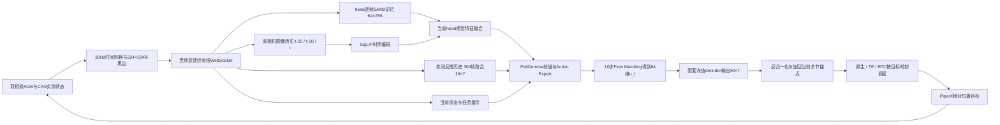

# 全量 TEMPO 模型部署与推理数据流

更新于 2026-11-15，北京时间。

## 目标与依据

部署 GPU-Server 原方法全量微调的第5000步策略，使用配套30步 decoder 与归一化统计。复用 tempo-lora 的连续反馈、SAM2记忆、三模式调度与动作时间锚点修复。

训练源码基线为 `taiyigong333/tempo_redo` main 提交 `60b59082bb4665a5edfa434e98c86cc75140807c`，已联网核对远端。训练入口为 `code/TEMPO/tools/piperx/train.py`，数据入口为同目录 `data.py`，正式配置为 `configs/gpu_paper_chunk30_4gpu_20261114.json`。实际部署结构以下载的 `model_config.json` 为准。

## 部署位置

| 内容 | 位置 |
|---|---|
| 4090部署根目录 | `/data/gcj_data/fast/baseline/tempo_full` |
| 完整策略加载入口 | `tempo/src/openpi/tempo_full/inference.py` |
| 启动入口 | `trained_model/scripts/serve_wired.sh` |
| 部署参数 | `trained_model/deployment.json` |
| 服务日志 | `trained_model/logs/serve_wired.log` |
| 模型服务 | `192.168.50.2:8002` |
| tmux会话 | `tempo_full_inference` |
| PiperX客户端根目录 | `/home/cv/gcj/project/baseline_fast/tempo-lora` |
| 新模型连接配置 | `client/configs/piperx_full.yaml` |
| 新模型图形入口 | `run_gui_full.sh` |

服务使用独立源码快照，Python环境复用 `/data/gcj_data/fast/baseline/tempo/tempo/.venv`，SAM2与tokenizer从部署配置所列的现有只读资产加载。迁移服务器时需要一并准备这些依赖，或通过配置及 `TEMPO_PYTHON` 修改路径。

## 模型文件

`trained_model/tempo_deploy/gpu/gpu_paper_chunk30_4gpu_20261114/` 下需要四个文件。

```text
policy/step_00005000/model.safetensors
policy/step_00005000/model_config.json
policy/step_00005000/norm_stats.json
auxiliary/decoder/best.pt
```

完整策略文件7551995332字节，共837个保存张量。启动时严格匹配模型权重，另行加载decoder并校验其窗口、潜变量维度、有效动作维度与policy_norm动作空间。下载残留的 `.incomplete` 文件会被就绪检查拒绝。训练机上的decoder绝对路径在部署时替换为本机配套文件路径。

## 操作命令

4090上检查文件与启动服务。

```bash
cd /data/gcj_data/fast/baseline/tempo_full
bash trained_model/scripts/serve_wired.sh --check-files
tmux new-session -d -s tempo_full_inference -c "$PWD" \
  'exec bash trained_model/scripts/serve_wired.sh >> trained_model/logs/serve_wired.log 2>&1'
curl --noproxy '*' http://192.168.50.2:8002/healthz
tail -f trained_model/logs/serve_wired.log
```

已有 `tempo_full_inference` 会话时可用 `tmux attach -t tempo_full_inference` 查看。服务会先完成原生与RTC预热，再开放端口。

PiperX上启动新模型界面。

```bash
cd /home/cv/gcj/project/baseline_fast/tempo-lora
bash run_gui_full.sh
```

也可以在现有界面选择 `client/configs/piperx_full.yaml`。新配置握手核验模型名 `pi05_piperx_tempo_full_chunk30`、step5000、30步、7维动作和30Hz反馈。界面按配置调整原生步数上限30、RTC最少推进上限29，并展示完整30行预测。模式可以选择原生、TE或RTC，首次保持只读，实机运动按现有界面的逐轮现场确认流程操作。

## 推理数据流



1. 客户端在30Hz网格采集6个关节角，单位rad，及夹爪开口，单位m。两路相机分别映射head与left_wrist，RGB等比补黑边为224×224。每次请求传入上次请求以来的全部连续实测反馈，并携带独立episode_id。
2. 双相机各取 `[t-20,t-10,t]` 三帧，约为当前之前0.667秒、0.333秒及当前。启动历史不足时重复首帧。此前LoRA模型使用1秒帧间距，本次从新模型配置读取0.333秒，并验证与新训练数据的整数索引一致。
3. SAM2按顺序消费每帧head图像并更新自身记忆，得到当前帧64×256 tokens。SAM2计算与双相机SigLIP视觉编码并行，在融合处等待当前批次特征。
4. 将已到达的实测反馈对应到训练的历史action。训练约定 `action[i]=state[i+1]`，因此在时刻t可以使用的历史为 `state[1]...state[t]`，最新反馈只对应 `action[t-1]`。取最近300帧，启动前补零，每30帧平均为1桶，共10×7。历史保持原始rad/m单位。
5. 当前state按新统计归一化并离散编码进π0.5任务文本。视觉特征、SAM2融合特征、任务文本和历史反馈tokens形成模型前缀，历史反馈同时作用于Action Expert的时间条件。
6. Action Expert从一个64维高斯噪声潜变量开始，进行10步flow采样，得到预测u_t，形状 `[1,64]`。配套冻结decoder将其解为 `[30,7]` 的归一化动作，模型接口内部补齐至32维。
7. 使用本次训练的分位归一化统计恢复动作尺度，前6维关节相对量加回本轮观测state，夹爪保持绝对开口。截取7维并转float32后经网络回传。
8. 客户端采用观测时刻作为锚点。原生跳过错过的预测步，TE按同一目标时刻融合多个动作块，RTC将已有绝对动作前缀转换到新观测锚点后进行decoder动作空间VJP引导。

MVAE及未来视频用于训练u_t标签构建。在线采样由策略预测u_t，部署只需要策略、decoder、归一化、tokenizer及SAM2资产。

## 30步与时间对应

设最新观测时刻为 $t_0$，块中从1开始计数的第 $k$ 步对应

$$
t_k=t_0+\frac{k}{30},\qquad k=1,\ldots,30.
$$

因此模型覆盖约1秒预测范围，之前16步覆盖约0.533秒。推理耗时后会跳过已经错过的步。例如200ms往返后，实际控制会从目标时刻仍可用的后续步开始，日志记录prediction_step、target_timestamp、下发时刻和TE融合来源。

当前控制配置的观测最大帧龄为0.5秒。这个值独立于模型chunk长度，后半段预测可供评估与后续策略研究，实际调度仍需要及时得到新观测和新预测。

## RTC论文参数入口

2026-11-15新增rtc_paper配置，服务仍在8002，采用5次去噪、beta5与10次延迟窗口最大值。客户端入口为run_gui_full_rtc_paper.sh。两种配置可以通过start_service.sh切换，详见 `RTC论文参数部署.md`。

## 首轮优化运行状态

模型已经完成下载并在8002提供服务。当前启用SAM2并行与局部编译，10次去噪。固定输入4例编译对照最大关节差约1.14°、夹爪差约0.96mm。

2026-11-15已部署两项精确执行优化，跳过全mask缺失相机编码，SAM2逐帧更新记忆并仅对每批最后一帧读取融合特征。27组固定输入配对动作逐元素一致。GPU训练结束后的配对基准P50约186→143ms，P95约325→223ms。候选三模式各20秒录制反馈持续调度通过，正式8002验收结果见 `推理保效果优化.md`。

自动验证使用录制数据与模拟机器人，机器人控制命令0。真实相机/CAN持续运行及抓取效果待现场验收。

## 验证与交接

验证结果及运行状态见同目录 `交接.md`。专项回归位于 `tests/test_full_deployment.py`，录制数据有线回放、实时调度模拟和编译数值对照脚本也保存在tests目录。实时调度模拟以30Hz重复录制帧，并使用模拟机器人。
